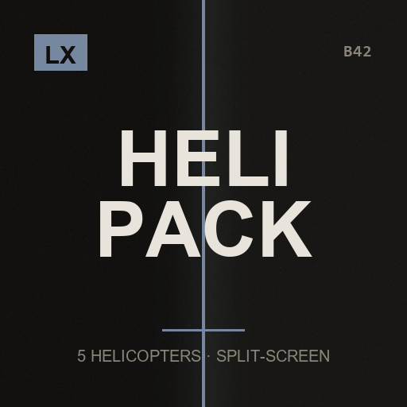

# LX Heli Pack Split-Screen Fix

**Player 2 flies too, and the sticks beat the keyboard**

> Heli Pack is five copies of the same code and 81% of its player lookups are pinned to player 1. Fixing that turned out to need 38 changes, not four hundred.

`Project Zomboid B42.21+` · `v1.0.0` · `CC0`

[English](#english) · [Español](#español) · [Русский](#русский)

---

## English

This mod is part of the **LX Split-Screen Suite**, seven mods that make Project Zomboid B42 playable in 2–4 player couch co-op, with or without a gamepad. Each one stands alone — install only what you need.

### Why split-screen?

Split-screen is the mode that carries the most bugs in stable B42 — and the mods worth playing with, like Bandits and Project A-Life, are built for singleplayer and online multiplayer. Nobody is fixing couch co-op. This suite exists to close that gap: to make split-screen as playable as the modes that get the attention.

### Why gamepad?

B42 keeps improving controller support, but it is still rough, and the aim-and-shoot rework left gunplay on a gamepad close to unusable — you cannot even shoot a zombie lying on the ground. Split-screen *with* a gamepad is the worst case the game offers. These mods give PZ back an aim that was designed for a stick: assist on the vertical axis, B41-style lock-on, per-player aim state, and a lot more.

### What it does

- **Player 2 could not fly at all** — The mod asks whether PLAYER 0 is sitting in an aircraft. If the one who climbed in is player 2, then as far as Heli Pack is concerned nobody is in any helicopter: no panel, no instruments, no controls. 76 of its 94 getSpecificPlayer calls are pinned to player 0.
- **And your helicopter was flown with the other player's controls** — This one is worse than being locked out. The flight loop simulates every aircraft passing player 0 in, so when player 2 is at the controls their machine reads player 1's inputs. Each aircraft is now simulated with the player who is actually driving it.
- **Both sticks now fly, and better than the keyboard** — There was no controller support whatsoever: zero JoypadState and zero getJoypadData across 42269 lines. Left stick is the collective and the pedals, right stick is the cyclic, with a dead zone that rescales so the travel still runs 0 to 1 instead of jumping. The keyboard gives -1, 0 or 1 and the flight model multiplies by that value, so an analog stick gives genuinely finer control than keys ever could.
- **The layout is yours to choose** — Default is how a real helicopter works: left stick climbs and turns, right stick is the cyclic. One setting swaps it for what you expect coming from a car. Dead zone and inverted vertical are there too. The Apache's and Kiowa's rebindable keys keep working exactly as before for whoever is on the keyboard.
- **Five helicopters, one set of patches** — Heli Pack is five copies of the same code, 87% to 98% identical, so every patch was written once and verified separately against all five. The Apache and the Kiowa needed their own variant because their keys are rebindable; the verifier caught that rather than me guessing, and their configurability is preserved.
- **Nothing of Heli Pack is redistributed** — Its files are read from your installed copy at load time, patched in memory and run from there. If Heli Pack updates and a snippet no longer matches, that patch is skipped with a note in console.txt and the original code runs unchanged.

### Requirements

| Mod | Workshop | |
|---|---|---|
| Heli Pack | [3822141121](https://steamcommunity.com/sharedfiles/filedetails/?id=3822141121) | required |

**Load order:** load this **after** `Heli Pack`. `mod.info` already declares it.

### Installing

**From the Steam Workshop (recommended)**
Subscribe on the Workshop page. Steam downloads it; then start Project Zomboid, go to
**Mods** in the main menu and enable it. In split-screen, enabling it once covers all players.

**Manually**
1. Download this repository (green **Code** button -> **Download ZIP**) and unzip it.
2. Copy the folder `LX_HeliPackSplit` into your Zomboid mods folder:
   - Windows: `C:\Users\<you>\Zomboid\mods\`
   - Linux: `~/Zomboid/mods/`
   - macOS: `~/Library/Application Support/Zomboid/mods/`
   The result must be `...\Zomboid\mods\LX_HeliPackSplit\42\mod.info`.
3. Start the game, open **Mods** in the main menu and enable **LX Heli Pack Split-Screen Fix**.

### Options

Main menu > Options > MODS > "LX Heli Pack Split": stick layout (helicopter or game), dead zone, and inverted vertical axis. The split-screen fixes are always on and have nothing to configure.

### Notes

- **Nothing is installed inside Heli Pack's folder.** Each patch is matched against an exact snippet; if Heli Pack updates and a snippet no longer matches, that patch is skipped with a note in `console.txt` and its original code runs unchanged. 38 changes across 23 files in 5 helicopters, every patched file compiled before shipping.
- A summary of how many changes were applied is printed in `console.txt` at game start. Worth a look the first time you launch.
- Verified against a simulator: 20 checks covering keyboard parity for a single player, the dead zone and its rescaling, both stick layouts, and which local player ends up flying. A player on keyboard with no controller gets exactly the original behaviour.
- Must load **after** Heli Pack. `mod.info` already declares it.
- Credit where it is due: Heli Pack is by RentCollectorClips and is not mine. Its 3D models carry their own CC BY 4.0 credits on its Workshop page, and none of that is touched or redistributed here.

### License

**CC0 1.0 Universal** — public domain dedication. Do whatever you want with it: copy it, change it, put it in a modpack, publish it, sell it. No permission needed, no credit required (though it is always welcome). See `LICENSE`.

### Support

If these mods made your co-op run work, you can buy me a coffee — 

### The rest of the suite

- [LX Coop Fixes](https://github.com/litoxperaloca/LX_CoopFixes) — Split-screen stability: vehicle crash, player 2 aiming, map stutter, error spam.
- [LX Split Aim](https://github.com/litoxperaloca/LX_SplitAim) — Controller aim assist and B41-style lock-on, per local player.
- [LX Split-Screen Quick Build](https://github.com/litoxperaloca/LX_SPLITSCREEN_CONTEXTMENU_BUILDING) — B41-style build menu in the context menu, because B42's window does not fit.
- [LX A-Life Split-Screen Fix](https://github.com/litoxperaloca/LX_ALifeSplit) — Project A-Life NPCs react to every local player, not just player 1.
- [LX Bandits Split-Screen Fix](https://github.com/litoxperaloca/LX_BanditsSplit) — Bandits target the right player, companions follow who recruited them.
- [LX Split-Screen Welcome Package](https://github.com/litoxperaloca/LX_SPLITSCREEN_WELCOME_PACKAGE) — A configurable starter kit per local character.
- [LX Split-Screen Skills Boost](https://github.com/litoxperaloca/LX_SPLITSCREEN_SKILLS_IMPROVE) — A configurable skill floor per local character.
- [LX Theodore Split-Screen Fix](https://github.com/litoxperaloca/LX_TheodoreSplit) — Theodore, the family NPC, reacts to every local player and works with a gamepad.
- [LX NPC Bases Split-Screen Fix](https://github.com/litoxperaloca/LX_NPCBasesSplit) — Bandit settlements open on your half of the screen, take a gamepad, and keep appearing as you travel.
- [LX HydeCo Underground Split-Screen Fix](https://github.com/litoxperaloca/LX_HydeCoSplit) — Each player gets their own breathing panel underground, opened and driven by their own gamepad.

---

## Español

> Heli Pack son cinco copias del mismo codigo y el 81% de sus busquedas de jugador estan clavadas en el jugador 1. Arreglarlo resulto ser 38 cambios, no cuatrocientos.

Este mod es parte de la **LX Split-Screen Suite**, siete mods que hacen jugable Project Zomboid B42 en coop de sillón de 2 a 4 jugadores, con o sin mando. Cada uno funciona por separado — instalá solo lo que precises.

### ¿Por qué pantalla dividida?

Es la modalidad con más bugs en la B42 estable — y los mods que valen la pena, como Bandits y Project A-Life, están pensados para un jugador y multijugador online. Nadie arregla el coop de sillón. Esta suite existe para cerrar esa brecha: dejar la pantalla dividida a la par de las modalidades que sí reciben atención.

### ¿Por qué mando?

La B42 viene mejorando el soporte de mando, pero todavía deja mucho que desear, y el rework de apuntado y disparo dejó el tiroteo con mando casi imposible — ni siquiera podés dispararle a un zombi en el suelo. Pantalla dividida *con* mando es el peor escenario posible del juego. Estos mods le devuelven a PZ un apuntado pensado para stick: asistencia en el eje vertical, fijado de blanco estilo B41, estado de apuntado por jugador, y bastante más.

### Qué hace

- **El jugador 2 directamente no podia volar** — El mod pregunta si el JUGADOR 0 esta sentado en una aeronave. Si el que se subio es el 2, para Heli Pack no hay nadie en ningun helicoptero: ni panel, ni instrumentos, ni controles. 76 de sus 94 llamadas a getSpecificPlayer estan clavadas en el jugador 0.
- **Y tu helicoptero se volaba con los controles del otro** — Este es peor que quedarse afuera. El bucle de vuelo simula cada aeronave pasando el jugador 0, asi que cuando pilotea el jugador 2 su maquina lee las entradas del jugador 1. Ahora cada aeronave se simula con el jugador que realmente la conduce.
- **Los dos sticks vuelan, y mejor que el teclado** — No habia absolutamente nada de mando: cero JoypadState y cero getJoypadData en 42269 lineas. El stick izquierdo es el colectivo y los pedales, el derecho es el ciclico, con una zona muerta que reescala para que el recorrido siga yendo de 0 a 1 en vez de arrancar de golpe. El teclado da -1, 0 o 1 y el modelo de vuelo multiplica por ese valor, asi que un stick analogico da un control realmente mas fino que el que las teclas podrian dar.
- **El mapeo lo elegis vos** — Por defecto es como funciona un helicoptero de verdad: stick izquierdo sube y gira, derecho es el ciclico. Una opcion lo cambia por lo que esperas viniendo de un auto. Tambien estan la zona muerta y el eje vertical invertido. Las teclas reconfigurables del Apache y el Kiowa siguen funcionando igual para quien juega con teclado.
- **Cinco helicopteros, un solo juego de parches** — Heli Pack son cinco copias del mismo codigo, entre 87% y 98% identicas, asi que cada parche se escribio una vez y se verifico por separado contra las cinco. El Apache y el Kiowa necesitaron su propia variante porque sus teclas son reconfigurables: lo detecto el verificador en vez de yo adivinarlo, y esa configurabilidad se conserva.
- **No se redistribuye nada de Heli Pack** — Sus archivos se leen de tu copia instalada al cargar, se parchean en memoria y se ejecutan desde ahi. Si Heli Pack se actualiza y un fragmento deja de coincidir, ese parche se omite con un aviso en console.txt y el codigo original corre sin cambios.

### Requisitos

| Mod | Workshop | |
|---|---|---|
| Heli Pack | [3822141121](https://steamcommunity.com/sharedfiles/filedetails/?id=3822141121) | obligatorio |

**Orden de carga:** cargá este **después** de `Heli Pack`. El `mod.info` ya lo declara.

### Instalación

**Desde el Steam Workshop (recomendado)**
Suscribite en la página del Workshop. Steam lo descarga solo; después abrí Project Zomboid,
andá a **Mods** en el menú principal y activalo. En pantalla dividida, con activarlo una vez
alcanza para todos los jugadores.

**A mano**
1. Descargá este repositorio (botón verde **Code** -> **Download ZIP**) y descomprimilo.
2. Copiá la carpeta `LX_HeliPackSplit` a tu carpeta de mods de Zomboid:
   - Windows: `C:\Users\<vos>\Zomboid\mods\`
   - Linux: `~/Zomboid/mods/`
   - macOS: `~/Library/Application Support/Zomboid/mods/`
   Tiene que quedar `...\Zomboid\mods\LX_HeliPackSplit\42\mod.info`.
3. Abrí el juego, entrá a **Mods** en el menú principal y activá **LX Heli Pack Split-Screen Fix**.

### Opciones

Menu principal > Opciones > MODS > "LX Heli Pack Split": mapeo de sticks (helicoptero o juego), zona muerta y eje vertical invertido. Las correcciones de pantalla dividida estan siempre activas y no se configuran.

### Notas

- **No se instala nada dentro de la carpeta de Heli Pack.** Cada parche se compara contra un fragmento exacto; si Heli Pack se actualiza y un fragmento deja de coincidir, ese parche se omite con un aviso en `console.txt` y su codigo original corre sin cambios. 38 cambios en 23 archivos de 5 helicopteros, y cada archivo parcheado se compilo antes de publicarlo.
- Al iniciar la partida se imprime en `console.txt` un resumen de cuantos cambios se aplicaron. Vale la pena mirarlo la primera vez.
- Verificado con un simulador: 20 pruebas sobre la paridad con el teclado jugando solo, la zona muerta y su reescalado, los dos mapeos de sticks, y que jugador local termina volando. A quien juega con teclado y sin mando no se le cambia nada.
- Debe cargar **despues** de Heli Pack. El `mod.info` ya lo declara.
- El credito donde corresponde: Heli Pack es de RentCollectorClips y no es mio. Sus modelos 3D llevan sus propios creditos CC BY 4.0 en su pagina del Workshop, y nada de eso se toca ni se redistribuye aca.

### Licencia

**CC0 1.0 Universal** — dedicado al dominio público. Hacé lo que quieras: copialo, cambialo, metélo en un modpack, publicalo, vendelo. No hace falta permiso ni crédito (aunque siempre se agradece). Ver `LICENSE`.

### Apoyar

Si estos mods te arreglaron el coop, podés invitarme un café — 

### El resto de la suite

- [LX Coop Fixes](https://github.com/litoxperaloca/LX_CoopFixes) — Estabilidad en pantalla dividida: crash de vehículos, apuntado del jugador 2, tirones del mapa, spam de errores.
- [LX Split Aim](https://github.com/litoxperaloca/LX_SplitAim) — Asistencia de apuntado con mando y fijado de blanco estilo B41, por jugador local.
- [LX Split-Screen Quick Build](https://github.com/litoxperaloca/LX_SPLITSCREEN_CONTEXTMENU_BUILDING) — Menú de construcción estilo B41 en el menú contextual, porque la ventana de B42 no entra.
- [LX A-Life Split-Screen Fix](https://github.com/litoxperaloca/LX_ALifeSplit) — Los NPCs de Project A-Life reaccionan a todos los jugadores locales, no solo al 1.
- [LX Bandits Split-Screen Fix](https://github.com/litoxperaloca/LX_BanditsSplit) — Los bandidos apuntan al jugador correcto, los compañeros siguen a quien los reclutó.
- [LX Split-Screen Welcome Package](https://github.com/litoxperaloca/LX_SPLITSCREEN_WELCOME_PACKAGE) — Un equipo inicial configurable por personaje local.
- [LX Split-Screen Skills Boost](https://github.com/litoxperaloca/LX_SPLITSCREEN_SKILLS_IMPROVE) — Un piso de habilidades configurable por personaje local.
- [LX Theodore Split-Screen Fix](https://github.com/litoxperaloca/LX_TheodoreSplit) — Theodore, el NPC familiar, reacciona a todos los jugadores locales y anda con mando.
- [LX NPC Bases Split-Screen Fix](https://github.com/litoxperaloca/LX_NPCBasesSplit) — Los asentamientos de bandidos se abren en tu mitad de pantalla, andan con mando, y siguen apareciendo mientras viajas.
- [LX HydeCo Underground Split-Screen Fix](https://github.com/litoxperaloca/LX_HydeCoSplit) — Cada jugador tiene su propio panel de respiracion bajo tierra, abierto y manejado con su propio mando.

---

## Русский

> Heli Pack — пять копий одного кода, и 81% обращений к игроку привязан к первому. Исправление заняло 38 изменений, а не четыреста.

Этот мод входит в набор **LX Split-Screen Suite** — семь модов, которые делают Project Zomboid B42 играбельным в совместной игре на диване для 2–4 человек, с геймпадом или без. Каждый работает сам по себе — ставьте только нужное.

### Почему разделённый экран?

Разделённый экран — режим с наибольшим числом ошибок в стабильной B42, а моды, ради которых стоит играть, вроде Bandits и Project A-Life, сделаны под одиночную игру и сетевой мультиплеер. Совместной игрой на диване не занимается никто. Этот набор существует, чтобы закрыть пробел: сделать разделённый экран таким же играбельным, как режимы, которым достаётся внимание.

### Почему геймпад?

B42 продолжает улучшать поддержку контроллеров, но она всё ещё сырая, а переработка прицеливания и стрельбы сделала перестрелки с геймпада почти невозможными — вы даже не можете выстрелить в зомби, лежащего на полу. Разделённый экран *вместе* с геймпадом — худший случай, который предлагает игра. Эти моды возвращают PZ прицеливание, рассчитанное на стик: помощь по вертикальной оси, захват цели в стиле B41, отдельное состояние прицеливания для каждого игрока и многое другое.

### Что делает

- **Второй игрок вообще не мог летать** — Мод спрашивает, сидит ли ПЕРВЫЙ игрок в летательном аппарате. Если забрался второй, то для Heli Pack в вертолёте нет никого: ни панели, ни приборов, ни управления. 76 из 94 вызовов getSpecificPlayer привязаны к первому игроку.
- **А ваш вертолёт летел по чужим органам управления** — Это хуже, чем остаться без доступа. Цикл полёта симулирует каждый аппарат, передавая первого игрока, поэтому за штурвалом второго машина читала ввод первого. Теперь каждый аппарат симулируется тем, кто им действительно управляет.
- **Оба стика летают, и лучше клавиатуры** — Поддержки геймпада не было совсем: ноль JoypadState и ноль getJoypadData на 42269 строк. Левый стик — общий шаг и педали, правый — ручка циклического шага, с мёртвой зоной, которая масштабирует остаток. Клавиатура даёт -1, 0 или 1, а модель полёта умножает на это значение, так что аналоговый стик даёт заметно более тонкое управление.
- **Раскладку выбираете вы** — По умолчанию — как у настоящего вертолёта. Одна настройка меняет её на привычную по автомобилю. Есть мёртвая зона и инверсия вертикали. Переназначаемые клавиши Apache и Kiowa продолжают работать как прежде.
- **Пять вертолётов, один набор патчей** — Heli Pack — пять копий одного кода, идентичных на 87-98%, поэтому каждый патч написан один раз и проверен отдельно против всех пяти. Apache и Kiowa потребовали своего варианта: это обнаружил проверяющий скрипт, а не догадка.
- **Ничего из Heli Pack не распространяется** — Его файлы читаются из вашей копии при загрузке, патчатся в памяти и запускаются оттуда. Если мод обновится и фрагмент перестанет совпадать, патч пропускается с записью в console.txt.

### Требования

| Mod | Workshop | |
|---|---|---|
| Heli Pack | [3822141121](https://steamcommunity.com/sharedfiles/filedetails/?id=3822141121) | обязательно |

**Порядок загрузки:** загружайте этот мод **после** `Heli Pack`. `mod.info` уже это объявляет.

### Установка

**Из Steam Workshop (рекомендуется)**
Подпишитесь на странице Workshop. Steam скачает мод сам; затем запустите Project Zomboid,
откройте **Моды** в главном меню и включите его. При разделённом экране достаточно включить
один раз — это работает для всех игроков.

**Вручную**
1. Скачайте этот репозиторий (зелёная кнопка **Code** -> **Download ZIP**) и распакуйте.
2. Скопируйте папку `LX_HeliPackSplit` в папку модов Zomboid:
   - Windows: `C:\Users\<вы>\Zomboid\mods\`
   - Linux: `~/Zomboid/mods/`
   - macOS: `~/Library/Application Support/Zomboid/mods/`
   Должно получиться `...\Zomboid\mods\LX_HeliPackSplit\42\mod.info`.
3. Запустите игру, откройте **Моды** в главном меню и включите **LX Heli Pack Split-Screen Fix**.

### Настройки

Главное меню > Настройки > МОДЫ > «LX Heli Pack Split»: раскладка стиков, мёртвая зона и инверсия вертикали. Исправления разделённого экрана всегда активны.

### Примечания

- **Внутрь папки Heli Pack ничего не устанавливается.** Если мод обновится и фрагмент перестанет совпадать, патч пропускается. 38 изменений в 23 файлах пяти вертолётов, каждый файл скомпилирован перед публикацией.
- При запуске игры в `console.txt` выводится сводка применённых изменений.
- Проверено на симуляторе: 20 проверок. Игроку с клавиатурой и без геймпада поведение не меняется.
- Загружать **после** Heli Pack.
- Heli Pack — мод RentCollectorClips, не мой. Его 3D-модели имеют свои указания CC BY 4.0 на странице мода, и здесь они не затрагиваются.

### Лицензия

**CC0 1.0 Universal** — передано в общественное достояние. Делайте что угодно: копируйте, изменяйте, включайте в сборки модов, публикуйте, продавайте. Разрешение не требуется, указание авторства не обязательно (но всегда приятно). См. `LICENSE`.

### Поддержать

Если эти моды помогли вашей совместной игре, можете угостить меня кофе — 

### Остальные моды набора

- [LX Coop Fixes](https://github.com/litoxperaloca/LX_CoopFixes) — Стабильность разделённого экрана: вылет транспорта, прицеливание второго игрока, подтормаживания карты.
- [LX Split Aim](https://github.com/litoxperaloca/LX_SplitAim) — Помощь прицеливания с геймпада и захват цели в стиле B41 для каждого локального игрока.
- [LX Split-Screen Quick Build](https://github.com/litoxperaloca/LX_SPLITSCREEN_CONTEXTMENU_BUILDING) — Меню строительства в стиле B41 в контекстном меню, потому что окно B42 не помещается.
- [LX A-Life Split-Screen Fix](https://github.com/litoxperaloca/LX_ALifeSplit) — NPC из Project A-Life реагируют на всех локальных игроков, а не только на первого.
- [LX Bandits Split-Screen Fix](https://github.com/litoxperaloca/LX_BanditsSplit) — Бандиты целятся в нужного игрока, напарники следуют за тем, кто их нанял.
- [LX Split-Screen Welcome Package](https://github.com/litoxperaloca/LX_SPLITSCREEN_WELCOME_PACKAGE) — Настраиваемый стартовый набор для каждого локального персонажа.
- [LX Split-Screen Skills Boost](https://github.com/litoxperaloca/LX_SPLITSCREEN_SKILLS_IMPROVE) — Настраиваемый минимальный уровень навыков для каждого локального персонажа.
- [LX Theodore Split-Screen Fix](https://github.com/litoxperaloca/LX_TheodoreSplit) — Theodore реагирует на всех локальных игроков и работает с геймпадом.
- [LX NPC Bases Split-Screen Fix](https://github.com/litoxperaloca/LX_NPCBasesSplit) — Поселения бандитов открываются на вашей половине экрана, работают с геймпадом и продолжают появляться по мере путешествия.
- [LX HydeCo Underground Split-Screen Fix](https://github.com/litoxperaloca/LX_HydeCoSplit) — У каждого игрока своя панель дыхания под землёй, открываемая и управляемая своим геймпадом.

